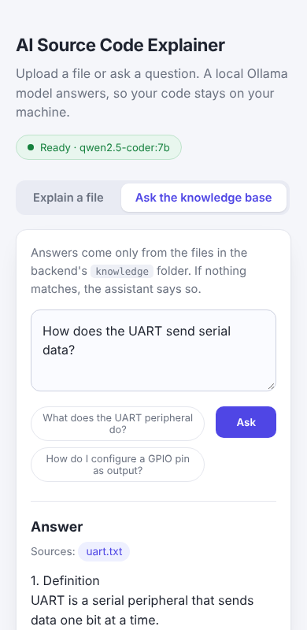

# AI-Assisted Knowledge Retrieval System

A local AI assistant that explains source code and answers questions from a folder of your own documents. An Angular web app talks to a Node.js/Express API, which finds the relevant text in the uploaded files and passes it to a locally running [Ollama](https://ollama.com) model. No cloud AI service and no API key are involved, so your files never leave your machine.

> Built during my one-month internship at Instrutel Systems Pvt. Ltd. (May 2026). My part was the Angular frontend, the connection to the Node.js REST APIs and the integration with the local Ollama model. This repository contains only my own work and no company data. The knowledge folder is empty and git-ignored.

## Problem statement

Reading unfamiliar embedded-systems or driver code is slow, and general chatbots answer from the internet rather than from the documents a team actually uses. Pasting proprietary code into a hosted AI service is also not always allowed. This project shows one way around both: a retrieval step feeds the model only your own files, and the model runs locally.

## Features

- **Explain a file:** drag and drop a source file (C, C++, Python, JavaScript, Java and about 20 other text formats) and get a structured explanation: purpose, walkthrough, key functions, possible issues.
- **Ask the knowledge base:** ask a question and get an answer built only from the uploaded documents, with the matching file names shown as sources. If nothing matches, the assistant says the information is not available.
- **Local and private:** runs on Ollama (`qwen2.5-coder:7b` by default).
- **Input validation:** file type whitelist, 2 MB size limit, sanitised file names, question length limit.
- **Clear error handling:** the UI tells you whether the backend is down, Ollama is down, the model is missing or the model timed out.
- **Status indicator** in the header shows backend and Ollama health.
- Responsive layout, copy-to-clipboard for answers, code blocks rendered safely (no `innerHTML`).
- Backend test suite (11 tests, uses a fake Ollama so no model is needed).

## Tech stack

| Part | Technology |
| --- | --- |
| Frontend | Angular 12, TypeScript, plain CSS |
| Backend | Node.js, Express, Multer, Axios |
| AI model | Ollama, `qwen2.5-coder:7b` (configurable) |
| Communication | REST / JSON |
| Tests | Node built-in test runner |

## System architecture

```
┌──────────────────────┐   HTTP/JSON    ┌────────────────────────────┐   HTTP    ┌──────────────┐
│  Angular frontend    │ ─────────────▶ │  Express backend           │ ────────▶ │   Ollama     │
│  localhost:4200      │ ◀───────────── │  localhost:3000            │ ◀──────── │  :11434      │
│  upload / ask / UI   │                │  upload · search · prompts │           │  local model │
└──────────────────────┘                └─────────────┬──────────────┘           └──────────────┘
                                                      │ read / write
                                              ┌───────▼────────┐
                                              │ backend/       │
                                              │ knowledge/     │  your files
                                              └────────────────┘
```

## Workflow

1. **Upload.** The browser checks file type and size, then sends the file to `POST /upload`. The server validates it again and saves it in `backend/knowledge/`.
2. **Retrieve.** For a question, the server splits every file into 5,000-character chunks, scores each chunk by how many of the question's keywords it contains, and keeps the best three.
3. **Prompt.** The chunks (or, when explaining a file, the first 12,000 characters of that file) are put into a prompt with strict rules to answer only from the supplied text.
4. **Generate.** The prompt goes to Ollama. The answer, the source file names and a `truncated` flag come back as JSON.
5. **Display.** The frontend splits the answer into text and code blocks and shows it.

## Getting started

### Requirements

- Node.js 18 or newer
- [Ollama](https://ollama.com/download) with the model pulled:

```bash
ollama pull qwen2.5-coder:7b
```

### Run the backend

```bash
cd backend
npm install
npm start          # http://localhost:3000
```

### Run the frontend

```bash
cd frontend
npm install
# Angular 12 needs this flag on Node 17 and newer (macOS/Linux):
export NODE_OPTIONS=--openssl-legacy-provider
# Windows PowerShell: $env:NODE_OPTIONS="--openssl-legacy-provider"
npm start          # http://localhost:4200
```

Open http://localhost:4200. The header badge turns green when the backend and Ollama are reachable.

### Run the tests

```bash
cd backend
npm test
```

### Configuration

All optional. See `backend/.env.example`. The server reads them from the environment (for example `PORT=4000 npm start`). The project needs no API keys. Never commit a real `.env` file; it is git-ignored.

| Variable | Default | Meaning |
| --- | --- | --- |
| `PORT` | `3000` | Backend port |
| `OLLAMA_URL` | `http://127.0.0.1:11434` | Where Ollama is running |
| `OLLAMA_MODEL` | `qwen2.5-coder:7b` | Model used for answers |
| `CORS_ORIGIN` | `http://localhost:4200` | Frontend origin allowed to call the API |
| `KNOWLEDGE_DIR` | `backend/knowledge` | Folder for uploaded files |

If you change the backend port, also change `apiUrl` in `frontend/src/environments/environment.ts`.

## API

| Method | Path | Description |
| --- | --- | --- |
| `POST` | `/upload` | Multipart field `file`. Returns `{ message, fileName, size }`. |
| `POST` | `/chat` | JSON `{ question, fileName? }`. With `fileName` it explains that file; without it, it answers from the knowledge folder. Returns `{ answer, sources, truncated }`. |
| `GET` | `/files` | Lists uploaded files. |
| `GET` | `/health` | Backend status and whether Ollama is reachable. |

Errors are JSON `{ error }` with a suitable status: 400 invalid input, 404 file not found, 413 file too large, 502 model error, 503 Ollama unreachable, 504 model timeout.

## Project structure

```
backend/
  server.js          Express API, retrieval, prompts, error handling
  test/api.test.js   Backend tests with a fake Ollama
  .env.example       Configuration template (no secrets)
  knowledge/         Uploaded files (not tracked by git)
frontend/src/app/
  app.component.*    Page shell, tabs, status badge
  uploads/           "Explain a file" screen
  chat/              "Ask the knowledge base" screen
  api.service.ts     Backend client
  answer-format.ts   Splits answers into text and code, error messages
web/                 Earlier standalone chat page (older API, kept for reference only)
docs/screenshots/    Screenshots used in this README
```

## Screenshots

The screenshots below were captured from the running app with the model replaced by a small stand-in server, so the answer text is a placeholder and not real model output. The interface is the real one.

| Explain a file | Ask the knowledge base |
| --- | --- |
|  |  |

| Home | File selected |
| --- | --- |
|  |  |

| Mobile |
| --- |
|  |

## Limitations

- Retrieval is keyword matching, not semantic search, so a question phrased with different words than the document may find nothing.
- Answer quality depends on the local model and on your hardware. A 7B model can be slow on a laptop without a GPU.
- Files are stored as they are uploaded, with no user accounts or authentication. Run it locally, not on a public server.
- Only plain-text formats are supported; PDFs and Word files are not parsed.
- A file with the same name replaces the earlier upload.

## Future enhancements

- Embedding-based (semantic) search with a vector store
- PDF and DOCX support
- Streaming answers and conversation history
- File management in the UI (list and delete uploaded files)
- Authentication and Docker setup for deployment
- Frontend unit tests and CI

## Author

Thirumala Shetty Rishitha, B.E. Computer Science, MVSR Engineering College, Hyderabad (class of 2027).
