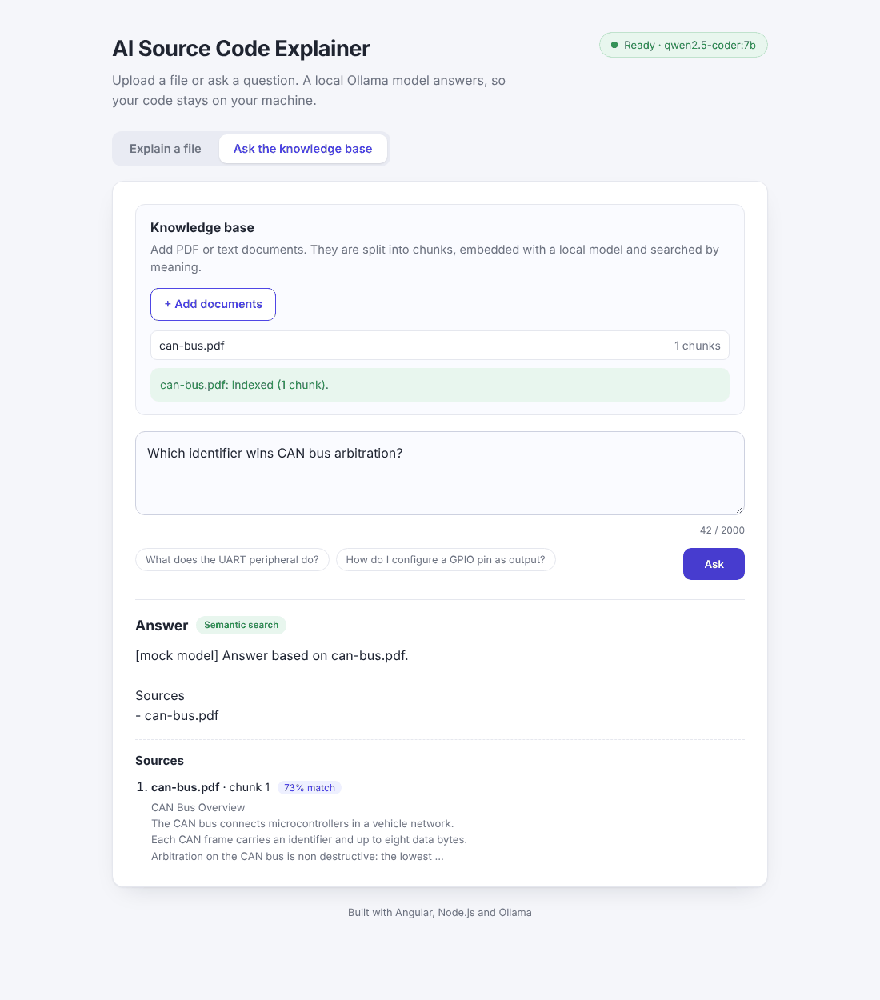
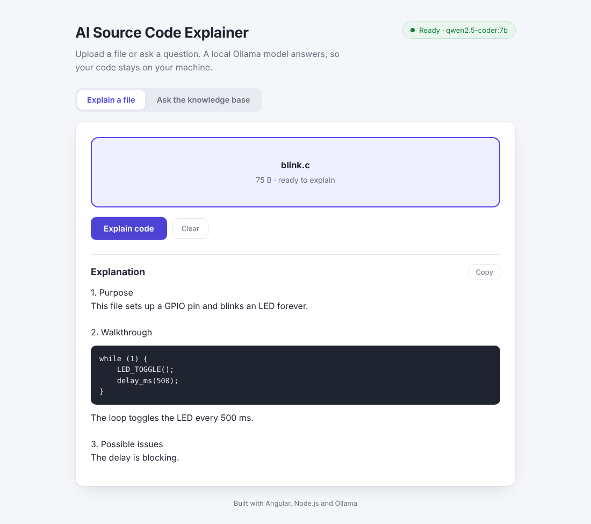
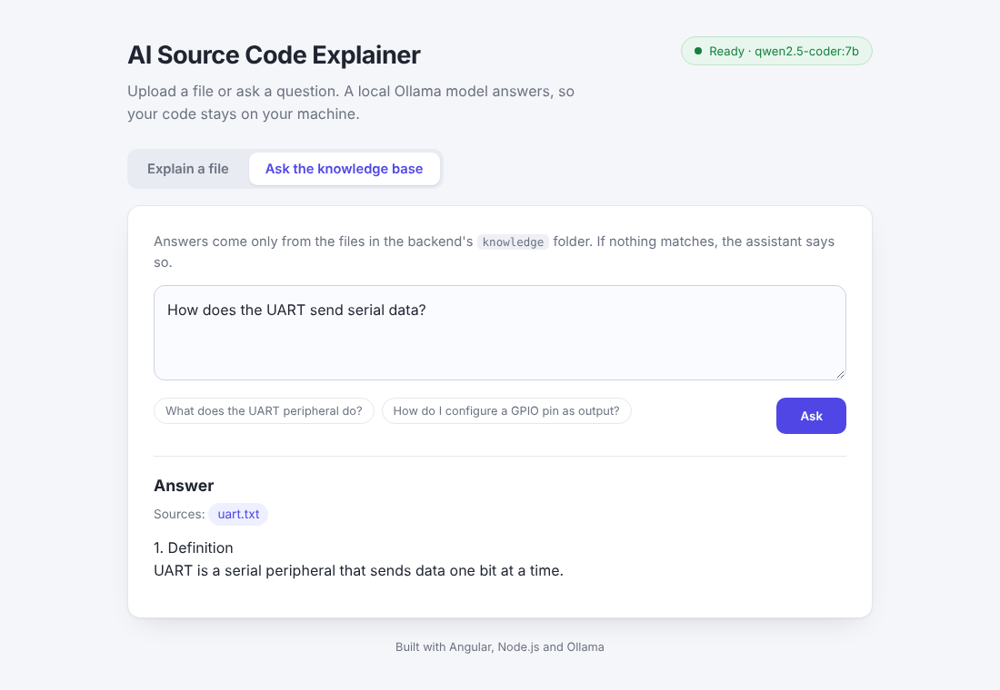
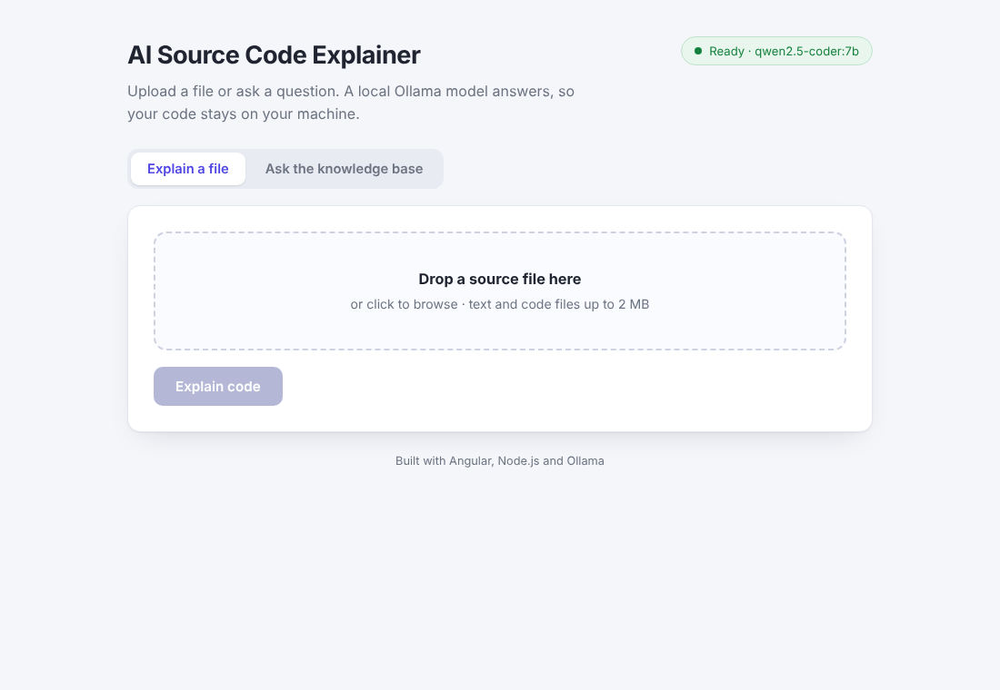
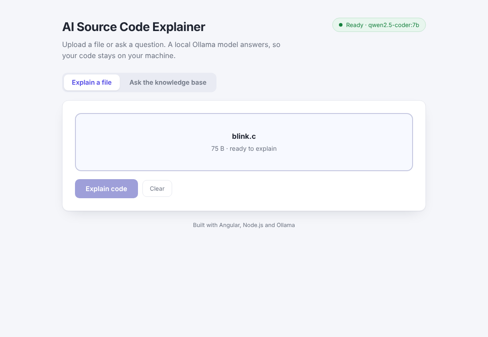

# AI-Assisted Knowledge Retrieval System

A local AI assistant that explains source code and answers questions from your own documents (PDF, text and code files). An Angular web app talks to a Node.js/Express API that uses retrieval-augmented generation (RAG): it finds the passages closest in meaning to your question using local embeddings, then passes them to a locally running [Ollama](https://ollama.com) model. No cloud AI service and no API key are involved, so your files never leave your machine.

> Built during my one-month internship at Instrutel Systems Pvt. Ltd. (May 2026). My part was the Angular frontend, the connection to the Node.js REST APIs and the integration with the local Ollama model. This repository contains only my own work and no company data. The knowledge folder is empty and git-ignored.

## Problem statement

Reading unfamiliar embedded-systems or driver code is slow, and general chatbots answer from the internet rather than from the documents a team actually uses. Pasting proprietary code into a hosted AI service is also not always allowed. This project shows one way around both: a retrieval step feeds the model only your own files, and the model runs locally.

## Features

- **Explain a file:** drop in a source file (C, C++, Python, JavaScript, Java and about 20 other text formats) or a PDF and get a structured explanation: purpose, walkthrough, key functions, possible issues.
- **Ask your documents (RAG):** upload PDFs or text files to the knowledge base and ask questions about them. Documents are split into chunks and embedded with a local embedding model, and each answer is built from the chunks closest in meaning to the question.
- **Source references:** every answer lists the documents and chunks it used, with a similarity score and a short preview.
- **No made-up answers:** if no chunk is similar enough to the question, the server replies that the information is not available and does not call the model at all.
- **Keyword fallback:** if the embedding model is not installed, documents are still saved and questions are answered with keyword search. The UI labels which retrieval method was used.
- **Small talk:** greetings such as "hello" or "thanks" get a normal reply instead of a document search.
- **Local and private:** runs on Ollama (`qwen2.5-coder:7b` for answers and `nomic-embed-text` for embeddings by default). No API keys, no cloud services.
- **Input validation:** file type whitelist, size limits (2 MB for text, 10 MB for PDF), sanitised file names and a question length limit, checked on both client and server.
- **Clear error handling:** the UI tells you whether the backend is down, Ollama is down, a model is missing or the model timed out.
- **Status indicator** in the header shows backend and Ollama health.
- Responsive layout, copy-to-clipboard for answers, code blocks rendered safely (no `innerHTML`).
- Tests: 30 backend tests (API, RAG pipeline, configuration) and 12 frontend unit tests. They use a fake Ollama server, so you don't need to download a model to run them.

## Tech stack

| Part | Technology |
| --- | --- |
| Frontend | Angular 12, TypeScript, plain CSS |
| Backend | Node.js, Express, Multer, Axios |
| Text extraction | `pdf-parse` for PDFs, UTF-8 for text and code |
| Embeddings | Ollama `nomic-embed-text` (configurable), via `/api/embed` |
| Vector store | JSON file on disk with in-memory cosine-similarity search (`backend/rag.js`) |
| Answer model | Ollama `qwen2.5-coder:7b` (configurable), via `/api/generate` |
| Communication | REST / JSON |
| Tests | Node built-in test runner (backend), Karma + Jasmine (frontend) |

A separate vector database would be overkill for a few hundred documents on one machine, so the vectors are kept in one JSON file (`backend/knowledge/.vector-store.json`, git-ignored) and searched with a linear scan. That is fast at this size.

## System architecture

```
┌──────────────────────┐   HTTP/JSON    ┌──────────────────────────────┐   HTTP    ┌──────────────────────┐
│  Angular frontend    │ ─────────────▶ │  Express backend (server.js) │ ────────▶ │  Ollama  :11434      │
│  localhost:4200      │ ◀───────────── │  localhost:3000              │ ◀──────── │  nomic-embed-text    │
│  explain / ask / KB  │                │  upload · retrieve · prompt  │           │  qwen2.5-coder:7b    │
└──────────────────────┘                └──────────────┬───────────────┘           └──────────────────────┘
                                                       │
                                     ┌─────────────────▼──────────────────┐
                                     │ rag.js: extract → chunk → embed    │
                                     │ backend/knowledge/   your files    │
                                     │ .vector-store.json   embeddings    │
                                     └────────────────────────────────────┘
```

## RAG workflow

**Indexing (when a document is uploaded)**

1. `POST /upload` checks the file type and size and saves the file in `backend/knowledge/`.
2. `rag.js` extracts the text: `pdf-parse` for PDFs, plain UTF-8 for everything else.
3. The text is split into chunks of about 1,000 characters with a 200-character overlap. Chunk ends move back to the nearest space so words are not cut. The overlap means a sentence that crosses a boundary is still complete in at least one chunk.
4. The chunks are sent to Ollama's `/api/embed` in batches of 16. Each chunk's vector is saved in `.vector-store.json` together with the file's size and modification time.
5. On startup, and when you call `POST /reindex`, files that were added or changed while the server was stopped are indexed, and deleted files are removed from the store.

**Answering (when a question is asked)**

1. Greetings and thanks are answered conversationally, without retrieval.
2. The question is embedded with the same model, and every stored chunk is scored by cosine similarity.
3. The best 4 chunks with a score of at least 0.3 are kept (`RAG_TOP_K`, `RAG_MIN_SCORE`).
4. If none qualify, the API answers "Information not available in institutional database." without calling the model.
5. Otherwise the chunks are numbered, labelled with their file names and put into a prompt that tells the model to answer only from them and to list the files it used.
6. The response contains the answer, the source files and a `references` list (file, chunk number, score, preview), which the UI shows under the answer.

If embeddings can't be created (for example because `nomic-embed-text` was not pulled), uploads still work and questions fall back to the original keyword search. The response then has `retrieval: "keyword"`, and the UI shows a "Keyword search" label, so the two modes can't be confused.

**Explain a file** uses the same extraction step. It sends the first 12,000 characters of the file to the model and adds related chunks from other documents as reference material.

## Getting started

### Requirements

- **Node.js 20.16 or newer** (22 LTS recommended). The PDF parser needs it.
- **[Ollama](https://ollama.com/download)** for Windows, macOS or Linux.
- **Hardware:** about 8 GB of free RAM for the 7B answer model. A GPU makes answers much faster, but a CPU works. The embedding model is small (about 270 MB) and runs quickly on a CPU.

### 1. Pull the models

```bash
ollama pull qwen2.5-coder:7b     # answers
ollama pull nomic-embed-text     # embeddings for RAG
```

Make sure Ollama is running (`ollama serve`, or the Ollama desktop app). `ollama list` should show both models.

### 2. Run the backend

```bash
cd backend
npm install
npm start          # http://localhost:3000
```

The startup log shows both model names. Documents already in `backend/knowledge/` are indexed automatically.

### 3. Run the frontend

```bash
cd frontend
npm install
# Angular 12 needs this flag on Node 17 and newer (macOS/Linux):
export NODE_OPTIONS=--openssl-legacy-provider
# Windows PowerShell: $env:NODE_OPTIONS="--openssl-legacy-provider"
npm start          # http://localhost:4200
```

Open http://localhost:4200. The header badge turns green when the backend and Ollama are reachable.

## Usage

1. Open **Ask the knowledge base** and click **+ Add documents**. You can pick several PDF or text files at once. Each file shows how many chunks were indexed.
2. Ask a question in your own words, for example:
   - "Which identifier wins CAN bus arbitration?"
   - "How do I configure a GPIO pin as output?"
   - "What does HAL_UART_Transmit return on timeout?"
3. Read the answer and check the **Sources** list under it. It shows which file and chunk each passage came from and how closely it matched.
4. Ask about something that is not in your documents. You should see the "not found in the uploaded documents" notice.
5. To explain a single file, switch to **Explain a file**, drop the file in and click **Explain code**.

## Running the tests

```bash
# backend: API, RAG pipeline and configuration tests (no Ollama needed)
cd backend
npm test

# frontend: unit tests in headless Chrome, then the production build
cd frontend
npm test -- --watch=false --browsers=ChromeHeadlessCI
npm run build
```

The backend tests start a small fake Ollama server. It returns deterministic bag-of-words embeddings, so chunking, PDF extraction, similarity search, source references, the keyword fallback and error handling are all exercised without downloading a model. Answer quality with a real model is not covered by the automated tests.

## Configuration

All settings are optional. See `backend/.env.example`. The server reads them from the environment (for example `PORT=4000 npm start`). The project needs no API keys. Never commit a real `.env` file; it is git-ignored.

| Variable | Default | Meaning |
| --- | --- | --- |
| `PORT` | `3000` | Backend port |
| `OLLAMA_URL` | `http://127.0.0.1:11434` | Where Ollama is running |
| `OLLAMA_MODEL` | `qwen2.5-coder:7b` | Model used for answers |
| `OLLAMA_EMBED_MODEL` | `nomic-embed-text` | Model used for embeddings. If you change it, the index is rebuilt on the next start |
| `CORS_ORIGIN` | `http://localhost:4200` | Frontend origin allowed to call the API |
| `KNOWLEDGE_DIR` | `backend/knowledge` | Folder for uploaded files |
| `VECTOR_STORE` | `<KNOWLEDGE_DIR>/.vector-store.json` | Where the embeddings are saved |
| `RAG_TOP_K` | `4` | Number of chunks given to the model |
| `RAG_MIN_SCORE` | `0.3` | Minimum cosine similarity for a chunk to count as relevant |

If you change the backend port, also change `apiUrl` in `frontend/src/environments/environment.ts`.

## Troubleshooting

| Symptom | Fix |
| --- | --- |
| Badge says "Backend not reachable" | Start the backend (`npm start` in `backend/`) and check that it runs on port 3000. |
| Badge says "Ollama not reachable" | Start Ollama (`ollama serve` or the desktop app). |
| Upload says "not indexed … ollama pull nomic-embed-text" | The embedding model is missing. Pull it, then click **Index unindexed documents**. |
| Answers are labelled "Keyword search" | Same cause: embeddings are unavailable, so the fallback is used. |
| "Model … is not available" | Run `ollama pull qwen2.5-coder:7b`, or set `OLLAMA_MODEL` to a model you have. |
| A PDF shows "No text could be extracted" | It is probably a scanned image. OCR is not supported. |
| `npm start` in `frontend/` fails with `ERR_OSSL_EVP_UNSUPPORTED` | Set `NODE_OPTIONS=--openssl-legacy-provider` as shown above. |
| `npm install` in `backend/` warns about the Node version | Install Node.js 20.16 or newer. |
| Answers are slow | 7B models are slow on a CPU. Try a smaller model such as `qwen2.5-coder:1.5b`. |

## API

| Method | Path | Description |
| --- | --- | --- |
| `POST` | `/upload` | Multipart field `file`. Saves and indexes the document. Returns `{ message, fileName, size, indexed, chunks, indexError? }`. |
| `POST` | `/chat` | JSON `{ question, fileName? }`. With `fileName` it explains that file; without it, it answers from the knowledge base. Returns `{ answer, sources, references, truncated, found, retrieval }`, where `retrieval` is `semantic`, `keyword` or `conversation`. |
| `GET` | `/files` | Lists uploaded files with their number of indexed chunks. |
| `POST` | `/reindex` | Indexes new or changed files and removes deleted ones from the vector store. |
| `GET` | `/health` | Backend status, model names, whether Ollama is reachable and the number of indexed chunks. |

Errors are JSON `{ error }` with a suitable status: 400 invalid input, 404 file not found, 413 file too large, 502 model error, 503 Ollama unreachable, 504 model timeout.

## Project structure

```
backend/
  server.js            Express API, retrieval, prompts, error handling
  rag.js               RAG pipeline: text extraction, chunking, embeddings, vector store, similarity search
  test/api.test.js     API tests with a fake Ollama
  test/rag.test.js     RAG tests: PDF/TXT ingestion, retrieval, sources, fallback, edge cases
  test/config.test.js  Startup with invalid configuration and Ollama unreachable
  test/fixtures/       Small sample PDF used by the tests
  .env.example         Configuration template (no secrets)
  knowledge/           Uploaded files and the vector store (not tracked by git)
frontend/src/app/
  app.component.*      Page shell, tabs, status badge
  uploads/             "Explain a file" screen and shared file validation
  chat/                "Ask the knowledge base" screen: document upload, answers, sources
  api.service.ts       Backend client
  answer-format.ts     Splits answers into text and code, error messages
web/                   Earlier standalone chat page (older API, kept for reference only)
docs/screenshots/      Screenshots used in this README
```

## Screenshots

These screenshots were taken from the running app with the answer model replaced by a small stand-in server, so the answer text is a placeholder, not real model output. Everything else is real. In the RAG screenshot, the PDF was actually uploaded, extracted, chunked, embedded (by the stand-in) and found by similarity search. Screenshots with a real model are still to be added.

| Ask the knowledge base (RAG with sources) |
| --- |
|  |

| Explain a file | Ask the knowledge base (before RAG) |
| --- | --- |
|  |  |

| Home | File selected |
| --- | --- |
|  |  |

| Mobile |
| --- |
|  |

## Limitations

- Retrieval quality depends on the embedding model, and you may need to tune `RAG_MIN_SCORE` for your documents. Set it too high and relevant chunks are dropped; too low and loosely related text gets in.
- The vector store is a JSON file searched linearly. That works for hundreds of documents, not for very large collections.
- Scanned PDFs are not supported (no OCR), and neither are DOCX files.
- Answer quality depends on the local model and your hardware. A 7B model can be slow on a laptop without a GPU.
- Each question is answered on its own; there is no conversation memory.
- There are no user accounts or authentication. Run it locally, not on a public server.
- Uploading a file with an existing name replaces the earlier file and its embeddings.
- The automated tests use a fake Ollama, so the pipeline has not been checked against a real model in CI.

## Future enhancements

- Deleting documents from the knowledge base in the UI
- Streaming answers and conversation history
- DOCX support, and OCR for scanned PDFs
- Hybrid search (keyword and vector scores combined) and re-ranking
- A real vector database (for example SQLite with a vector extension) for larger collections
- Docker setup, and CI that runs both test suites

## Team

| Member | GitHub | Role |
| --- | --- | --- |
| Thirumala Shetty Rishitha | [@rishiithathirumalashetty-gif](https://github.com/rishiithathirumalashetty-gif) | Owner. Built the original app during the Instrutel internship (Angular frontend, REST integration, Ollama integration) and maintains the repository. |
| Harshitha | [@harshitha0604](https://github.com/harshitha0604) | Collaborator (write access). Contributions will be listed here as they are merged. |

Rishitha is a B.E. Computer Science student at MVSR Engineering College, Hyderabad (class of 2027).

AI coding assistants (Claude) were used for parts of the later improvements, as noted in the commit messages. Every change is reviewed before it is merged. See [CONTRIBUTING.md](CONTRIBUTING.md) for how we work on the project.

